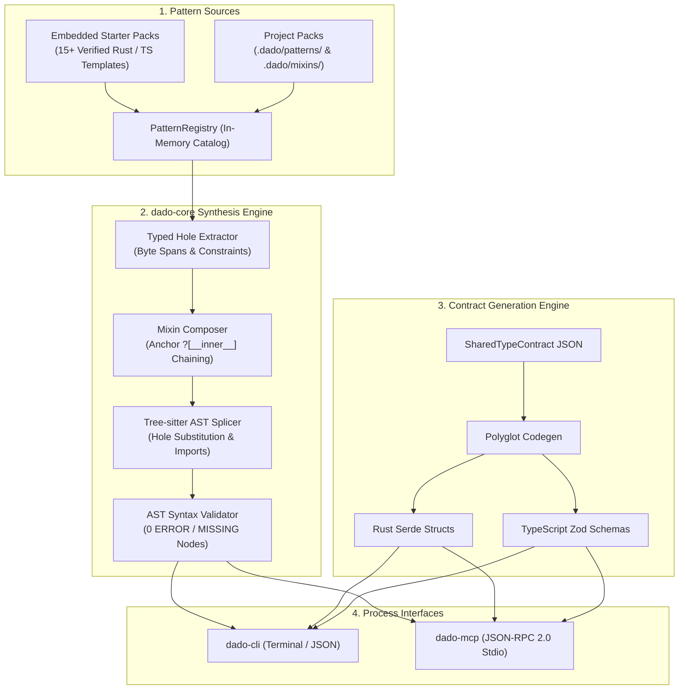

# System Architecture — `dado`

> **Crates:** `dado`, `dado-core`, `dado-cli`, `dado-mcp`  
> **Parsing Engine:** Polyglot Tree-sitter AST Grammars (Rust, TypeScript, JavaScript)  
> **Pattern Repositories:** Embedded Starter Packs (`include_str!`) + Local `.dado/`

---

## 1. System Overview & Dataflow

`dado` is a deterministic AST pattern and typed hole engine. It eliminates 85% of LLM boilerplate generation by providing structural templates with explicit typed holes (`?[id: Type @ kind]`), wrapping them in composable mixins, and validating spliced syntax trees using Tree-sitter.



---

## 2. Tree-sitter Splicing & Import Injection Architecture

When rendering a pattern, `dado` performs byte-level string replacements on pre-computed hole spans, followed by automated import resolution and AST verification:

```text
1. Parse Pattern:
   Extract all `?[id: Type @ kind]` byte spans into `Vec<InlineHoleSpan>`.

2. Chain Mixins:
   For each mixin in `--mixin`, locate `?[__inner__]` in the mixin template,
   re-indent the inner block, and wrap the code structurally.

3. Substitute Fills:
   Replace hole spans in reverse byte order to preserve coordinate validity.

4. Inject Imports:
   Inspect target source code AST for existing `use` or `import` statements;
   append missing imports required by the pattern and active mixins.

5. Tree-sitter Validation:
   Parse the completed source code using the language's Tree-sitter grammar;
   walk the syntax tree to ensure count(ERROR) == 0 and count(MISSING) == 0.
```

---

## 3. Crate & Package Topology

### `dado`
- **Path:** Root package (`src/lib.rs`)
- **Role:** Facade library crate re-exporting `dado-core` types, parsers, and errors for ergonomic downstream consumption.

### `dado-core`
- **Path:** `crates/dado-core`
- **Role:** Core domain library. Contains embedded starter packs, Tree-sitter parsers for Rust and TypeScript, typed hole span extractors, mixin composers, and contract codegen emitters. Contains zero CLI dependencies.

### `dado-cli`
- **Path:** `crates/dado-cli`
- **Role:** Command-line binary (`dado`). Exposes `list`, `inspect`, `render`, `contract`, `verify-pack`, and `init` subcommands with formatted table or `--json` outputs.

### `dado-mcp`
- **Path:** `crates/dado-mcp`
- **Role:** Model Context Protocol stdio server. Exposes tools (`dado_list_patterns`, `dado_inspect_pattern`, `dado_render`, `dado_emit_contract`, `dado_verify_pack`) for AI coding agents.
