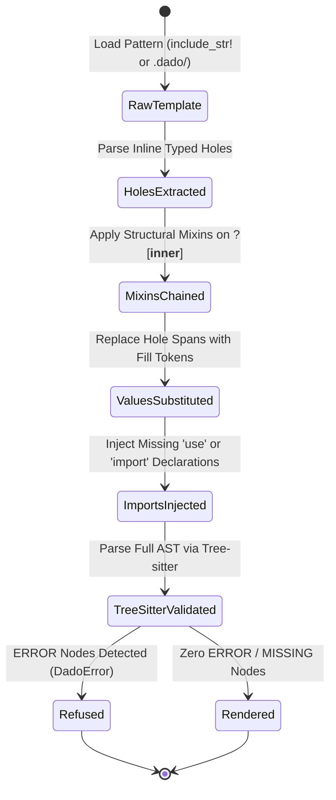
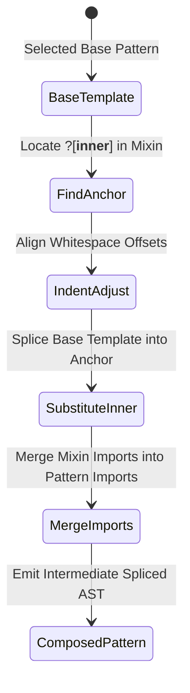

# Behavioral Specifications & Invariants — `dado`

> **Crates:** `dado`, `dado-core`, `dado-cli`, `dado-mcp`  
> **Parsing Engine:** Tree-sitter Polyglot Splicer  
> **Schema Version:** `1.0`

---

## 1. Core Behavioral Invariants

### Invariant 1: Tree-sitter Zero `ERROR` Node Invariant
* Spliced source code emitted by `dado` must parse cleanly under the respective language's Tree-sitter grammar (Rust, TypeScript, TSX, JavaScript).
* If an AST contains any `ERROR` or `MISSING` syntax nodes after hole substitution, rendering immediately fails with `DadoError::SplicingSyntaxError`.

### Invariant 2: Formal Typed Hole Grammar
* Holes are defined using the canonical grammar:
  ```text
  ?[<hole_id>: <ExpectedType> @ <ast_node_kind>]
  ```
  * `hole_id`: Unique identifier within the template matching `[a-z_][a-z0-9_]*`.
  * `ExpectedType`: Target semantic type constraint (e.g. `String`, `Json<User>`, `Result<T, E>`).
  * `ast_node_kind`: Expected Tree-sitter node type (e.g. `expression`, `identifier`, `statement`, `block`).

### Invariant 3: Structural Mixin Anchor Composition
* Composable structural mixins must define an explicit `?[__inner__]` anchor hole.
* When a mixin wraps a base pattern, the inner template is substituted into `?[__inner__]` preserving whitespace indentation and propagating required imports.

---

## 2. System State Machines

### 2.1 Pattern Splicing Lifecycle



### 2.2 Mixin Composition Pipeline



---

## 3. Formal Type Contracts

### Boundary Models, Wire Types & Enums

- **`mod::CanonicalType`** (`enum`): Neutral canonical primitive and compound types supported across polyglot boundaries (`String`, `I64`, `F64`, `Bool`, `Optional`, `List`, `Struct`).
- **`args::Cli`** (`struct`): Root command-line parser definition for `dado-cli`.
- **`args::Commands`** (`enum`): Top-level subcommand variants (`List`, `Inspect`, `Render`, `Contract`, `VerifyPack`, `Init`, `Mcp`).
- **`args::ContractArgs`** (`struct`): Command-line options for generating cross-language data schemas.
- **`error::DadoError`** (`enum`): Strongly typed domain error enum for all `dado-core` operations.
- **`model::DadoMixin`** (`struct`): Composable structural wrapper that envelopes an inner anchor hole.
- **`model::DadoPattern`** (`struct`): A parameterized AST pattern containing template code, typed holes, and imports.
- **`args::InitArgs`** (`struct`): Command-line options for initializing local project pattern packs.
- **`hole::InlineHoleSpan`** (`struct`): Parsed inline hole marker with byte offsets in the template string.
- **`args::InspectArgs`** (`struct`): Command-line options for inspecting pattern details.
- **`args::ListArgs`** (`struct`): Command-line options for filtering and searching registered patterns.
- **`args::McpArgs`** (`struct`): Arguments for starting the Model Context Protocol stdio daemon.
- **`mod::PatternRegistry`** (`struct`): In-memory catalog holding loaded AST patterns and structural mixins.
- **`model::PatternVerificationReceipt`** (`struct`): Verification result certifying pattern AST validity against test fills.
- **`args::RenderArgs`** (`struct`): Command-line options for rendering patterns with holes and mixins.
- **`mod::SpliceOptions`** (`struct`): Splicing options controlling import injection and AST validation strictness.
- **`model::SpliceResult`** (`struct`): Output payload containing rendered source code, injected imports, and AST stats.
- **`model::TypedHole`** (`struct`): Formal definition of a typed hole with ID, target type, and node kind.
- **`args::VerifyPackArgs`** (`struct`): Command-line options for auditing pattern packs.
